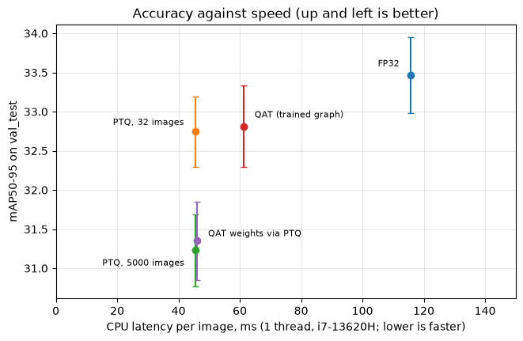

# rtod

Quantize and prune [YOLOX-Tiny](https://github.com/Megvii-BaseDetection/YOLOX), then measure what it
costs and what it buys, with a standard error on every accuracy number and the hardware named on every
speed number.

**INT8 makes the model 2.6x faster on a CPU and 3.6x smaller for under one point of mAP. Pruning costs far more
accuracy than that, and on a GPU the easy win is FP16.** Everything is reproducible from this repo, and every
model is published.

[](https://colab.research.google.com/github/leejianrong/real-time-object-detection/blob/main/notebooks/rtod_showcase.ipynb)
Weights: [Hugging Face](https://huggingface.co/jianlee/yolox-tiny-quantized). Full write-up: [docs/RESULTS.md](docs/RESULTS.md).



## Results

CPU: held-out COCO images (`val_test`, 2,476), one ONNX Runtime thread of an Intel i7-13620H, all models in one session.
`±` is a standard error, so differences under about one point are noise.

| Model | mAP50-95 | CPU latency | Size |
|---|---|---|---|
| FP32 (official weights) | 33.47 ± 0.49 | 115.6 ms | 20.3 MB |
| **INT8 post-training quantization** | **32.75 ± 0.45** | **45.4 ms** | **5.6 MB** |
| INT8 quantization-aware training | 32.81 ± 0.52 | 61.2 ms | 20.5 MB |

GPU (one RTX 2000 Ada, ONNX Runtime CUDA, batch 1): FP16 matches FP32's accuracy (33.47) at 3.12 ms against 3.57 ms,
in half the size. INT8 is slower than FP32 there, and TensorRT rejected our INT8 graphs (details in the write-up).

Pruning (30% of the multiply-adds removed) runs in 60 ms against 83 ms but scores 18.4 mAP against 32.8 on the
dev half, after recovery training. INT8 beats it on every axis.

Three findings worth knowing: calibrating on **32** images beat 5,000 (min/max ranges only widen), QAT only
*tied* well-calibrated PTQ, and the first PTQ baseline had been handicapped by over-calibration.

## Quick start

```bash
git clone https://github.com/leejianrong/real-time-object-detection && cd real-time-object-detection
make install          # uv sync with every extra (needs uv: https://docs.astral.sh/uv/)
make dashboard        # live FP32 vs INT8 on a traffic clip; prints a URL, open it in a browser
```

The first run downloads the models (46 MB) from Hugging Face. `make` lists everything else.

## Usage

Detect with a published model:

```python
import cv2
from rtod.detect import OrtDetector
from rtod.hub import fetch_model

detector = OrtDetector(fetch_model("ptq-int8"), conf=0.3)   # downloads once, checks the sha256
found = detector.detect(cv2.imread("street.jpg"))
for box, score, class_id in zip(found.boxes, found.scores, found.class_ids):
    print(class_id, round(float(score), 2), box)
```

Benchmark a model, with accuracy and memory:

```bash
uv run rtod bench model.onnx --variant my/model --eval val_test --jackknife 10 --resources
```

Quantize or prune your own copy:

```bash
uv run rtod quantize yolox_tiny_fp32.onnx out_int8.onnx --calib 32
uv run rtod prune --macs-removed 0.3 --out pruned.pt --onnx pruned.onnx
```

QAT and pruning recovery train on a GPU through `rtod job` (RunPod, hard spend cap); see [docs/RESULTS.md](docs/RESULTS.md#reproduce).
Run the notebook locally with `make notebook`.

## Contributing

Branch per change, PRs only, `make check` before pushing. Details in [CONTRIBUTING.md](CONTRIBUTING.md).

## Licence

Apache-2.0. YOLOX is by Megvii, also Apache-2.0; the demo clip is CC BY 3.0 (Sounds of Changes). See [NOTICE](NOTICE).
